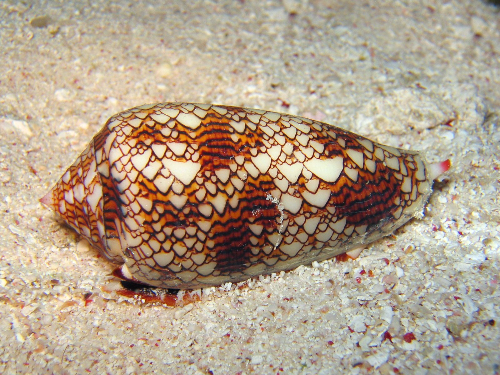

# ShellularAutomata



Shellular Automata is an experimental GPU playground for artificial life
(ALife). It explores continuous and multi-neighborhood cellular automata,
within the broader family of systems represented by
[Lenia](https://chakazul.github.io/lenia.html).

[](https://www.youtube.com/watch?v=2UpSYgUZbj0)

The cellular-automata work builds on the work of
[Slackermanz](https://github.com/Slackermanz/VulkanAutomata).

The repository also contains 2D fluid simulations.

## Build and run

After cloning the repository:
```sh
git submodule update --init --recursive
cmake -S . -B build -DCMAKE_BUILD_TYPE=Release
cmake --build build --parallel
./build/ShellularAutomata
```
